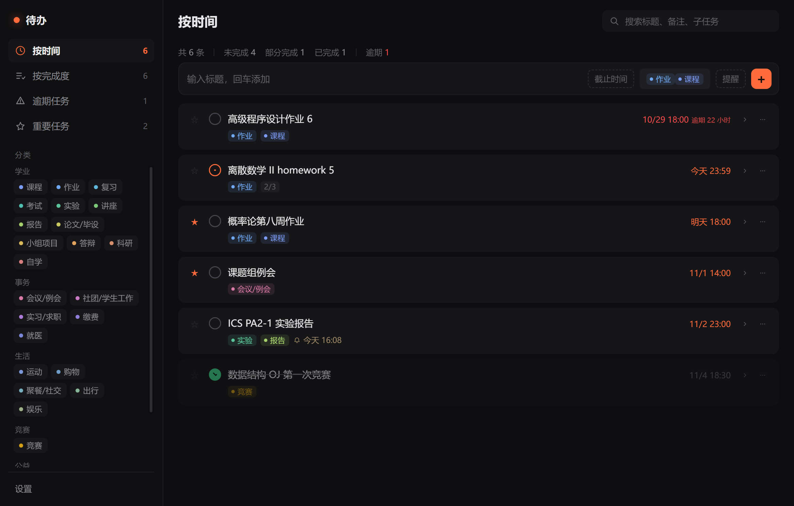

# WorkPlan · 待办与提醒

单机 Windows 桌面待办工具。截止时间必填、提醒可选，到点静默弹窗，不发出任何声音。



## 功能

- **三个入口 + 分类**：按时间 / 按完成度 / 逾期任务 / 重要任务
- **按时间**：全部任务一条时间轴，按截止时间升序；同一时刻按 `未完成 → 部分完成 → 已完成` 排
- **按完成度**：顶部三个标签切换未完成 / 部分完成 / 已完成
- **逾期任务**：未完成或部分完成且已过截止时间的，红色标出逾期时长
- **重要任务**：手动打星的聚合视图
- **子任务**：勾选任意一条，主任务自动进入「部分完成」
- **分类**：25 个固定分类，每条任务选 1–3 个；点分类过滤，任务命中任意一个即列出
- **提醒**：每条任务最多一个提醒时间；到点同时发系统通知 + 右下角置顶卡片，卡片不限张数堆叠
- **稍后提醒**：5 / 10 / 30 分钟或自定义分钟数；跨重启保留
- **错过补弹**：软件没开时错过的提醒，下次启动集中补弹
- **搜索**：标题、备注、子任务关键字，命中高亮
- **删除**：二次确认
- **常驻**：关闭窗口收进托盘，开机静默自启；全程无提示音

## 运行（开发）

```powershell
npm install
npm start
```

## 打包

```powershell
npm run dist
```

产物在 `dist/`：`WorkPlan Setup 0.1.0.exe`，安装后自动创建桌面与开始菜单快捷方式，可固定到任务栏。

## 安装 / 卸载

本机已安装一份：

- 程序目录：`%LOCALAPPDATA%\Programs\work-plan`
- 快捷方式：桌面 `WorkPlan`、开始菜单 `WorkPlan`
- 固定到任务栏：右键任务栏中的图标 → 「固定到任务栏」，或右键桌面快捷方式 → 「固定到任务栏」
- 卸载：设置 → 应用 → WorkPlan，或运行程序目录下的 `Uninstall WorkPlan.exe`

首次启动会自动登记开机自启（静默进托盘），可在「设置」里关闭。


## 数据

- 数据文件：`%APPDATA%\WorkPlan\data.json`
- 每日备份：`%APPDATA%\WorkPlan\backups\data-YYYY-MM-DD.json`，保留 7 份
- **独立备份**：`文档\WorkPlan备份\data-latest.json` + 每 10 分钟一份快照（保留 40 份）。
  每次修改都会同步到这里，即使 `%APPDATA%` 被整个删除也能找回。
- 写入采用「临时文件 + 重命名」原子替换；主文件损坏时自动从最近备份恢复

## 目录

```
src/main/main.js          主进程：窗口、托盘、提醒调度、IPC
src/main/store.js         数据读写、校验、备份、状态字段
src/main/categories.js    25 个分类（id / 名称 / 分组 / 颜色）
src/preload/preload.js    contextBridge 暴露的受限 API
src/renderer/index.html   主窗口
src/renderer/app.js       渲染逻辑：列表、行内编辑、弹层、搜索
src/renderer/reminder.*   提醒卡片窗口
assets/                   图标（含生成脚本 make_icons.py）
tools/selftest.js         界面自检脚本（--selftest）
tools/seed-demo.js        演示数据（仅开发）
```

## 自检

```powershell
# 界面交互自检（增删改查、状态流转、视图切换）
.\node_modules\electron\dist\electron.exe . --no-sandbox --selftest

# 提醒弹窗自检（出现、稍后、知道了、消失）
.\node_modules\electron\dist\electron.exe . --no-sandbox --remtest
```

默认使用 `%APPDATA%\WorkPlan`，测试时建议加 `--user-data-dir=./.devdata` 隔离。

## 说明

- 分类名只在 `src/main/categories.js` 里维护，改名字历史任务自动跟随（任务只存 id）。
- 托盘若在受限会话中创建失败（`Shell_NotifyIcon` 不可用），程序降级为「关闭即退出」，避免窗口消失后无法唤回；再次双击快捷方式总会把窗口叫出来。
- 开发态不写开机自启注册表，只有安装版才生效。
